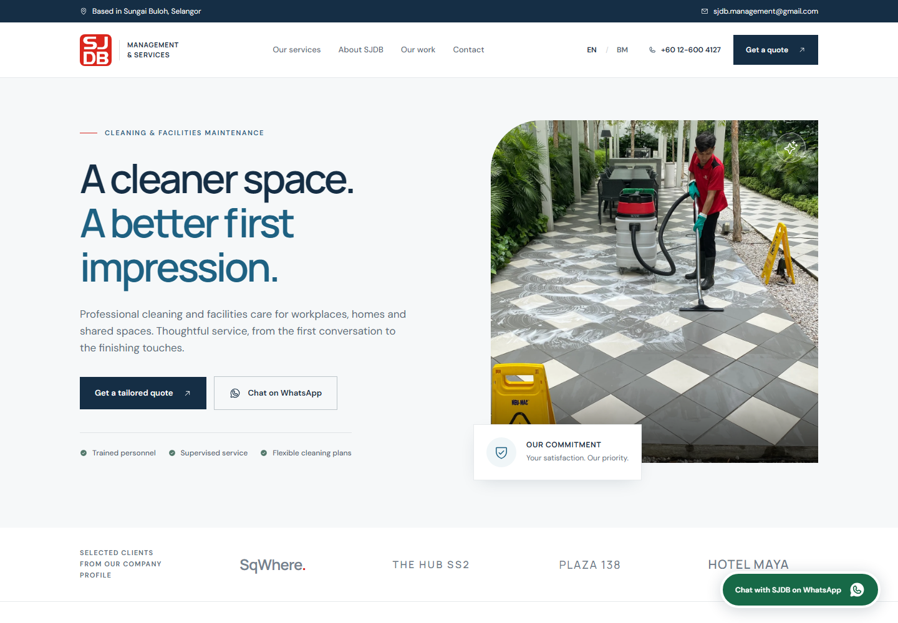

# SJDB landing page

A responsive English/Bahasa Melayu landing page for SJDB Management and Services (M) Sdn Bhd and SJDB Facilities Resources. Built with React, TypeScript, Vite and Tailwind CSS. Fonts, logo, photographs and the downloadable company profile are served locally.

Repository: [FixITSukil/SJDB-Website](https://github.com/FixITSukil/SJDB-Website). Customer presentation URL: [SJDB landing page](https://fixitsukil.github.io/SJDB-Website/). The public GitHub Pages deployment and live desktop/mobile checks passed on 20 October 2026.



## Run locally

Use Node.js **22.12 or newer** and npm. The installed Vite version also accepts Node.js 20.19 or newer in the 20.x line; see the lockfile for the exact dependency versions.

```sh
npm ci
npm run dev
```

Open the local URL printed by Vite. The development server listens on all network interfaces. No environment variables, API keys or database setup are required.

```sh
npm run build
npm run preview
```

`build` checks TypeScript, creates the production site in `dist/`, and prerenders the English page into HTML so its content is readable before JavaScript loads. The page then hydrates for bilingual content and interactive features. `preview` serves that build for a local check. Upload the contents of `dist/` to a static host; do not deploy `node_modules/`, `tmp/` or research working files. Vite's relative base (`./`) and relative public asset/PDF URLs support both a domain root and a project subdirectory such as a GitHub Pages repository URL.

## Publish with GitHub Pages

GitHub Actions is configured to publish the site automatically on pushes to `main`. The workflow in `.github/workflows/deploy-pages.yml` installs the locked dependencies with Node.js 22, builds and prerenders the site, and deploys only `dist/`. It can also be started manually from the repository's Actions tab. A successful deployment exposes the presentation URL in the `github-pages` environment and the workflow summary.

The build receives `SITE_URL` from GitHub Pages and uses it for canonical, sharing and structured-data website URLs. For another static host, set `SITE_URL` to the complete public site URL, including any project path, before running `npm run build`. Without `SITE_URL`, a local build remains portable and does not assume a production domain.

The official action release versions were checked on 20 October 2026: [checkout](https://github.com/actions/checkout/releases), [setup-node](https://github.com/actions/setup-node/releases), [configure-pages](https://github.com/actions/configure-pages/releases), [upload-pages-artifact](https://github.com/actions/upload-pages-artifact/releases) and [deploy-pages](https://github.com/actions/deploy-pages/releases). See [GitHub's custom Pages workflow guide](https://docs.github.com/en/pages/getting-started-with-github-pages/using-custom-workflows-with-github-pages) for the repository publishing setup.

## Enquiries and interaction

- The language selector changes the visible copy and document language. The browser stores the selection under `sjdb-language` in local storage; the selector still works when storage is unavailable.
- Service categories and project filters switch content on the page. Project cards open a native dialog. Service enquiry buttons preselect a service in the contact form.
- Call links open the device's phone handler. WhatsApp links open `wa.me` using SJDB's profile mobile number. Email links use the visitor's configured email application.
- The contact form prepares a message and opens WhatsApp or an email draft. **The visitor must review and send the message in that application.** The page has no enquiry backend, email delivery service, database, booking system or payment processing. It does not confirm message delivery. A prepared-message link remains available if the external application did not open automatically.
- The directions link searches Google Maps using the profile address; it is not a verified Google Business Profile link.

## Content and contact updates

| Location                               | Update here                                                                                                                                             |
| -------------------------------------- | ------------------------------------------------------------------------------------------------------------------------------------------------------- |
| `src/content.ts`                       | English/BM copy, service categories, project titles, locations, scopes and image references                                                             |
| `src/App.tsx`                          | `contact` object near the top, enquiry formatting, `wa.me` links, visible formatted phone numbers, postal address, legal names and registration numbers |
| `index.html`                           | Page title, description, sharing metadata, favicon and LocalBusiness structured data, including phone, email and address                                |
| `src/styles.css`                       | Shared layout, interaction, focus and responsive styles                                                                                                 |
| `public/assets/`                       | Extracted company logo and optimized photographs                                                                                                        |
| `public/sjdb-company-profile-2026.pdf` | Downloadable company profile                                                                                                                            |

The WhatsApp target is also embedded in both the general WhatsApp link and form-submit handler. When changing a phone number, check every `tel:`/`wa.me` target, visible phone number and the structured data together. Maintain both languages when changing content. There is no central environment-based contact configuration.

Current profile contacts:

- Mobile/WhatsApp target: `+60 12-600 4127` (`60126004127` for `wa.me`).
- Office: `+60 3-6038 3285`.
- Management email: `sjdb.management@gmail.com`.
- Facilities email: `sjdbfr@gmail.com`.
- Main address: No. 28G, Jalan DC 4/3, Desa Coalfields, 47000 Sungai Buloh, Selangor, Malaysia.

## Source provenance

The customer supplied `SJDB PROFILE 2026.pdf`, a 22-page company profile. Its web download is optimized from 84 MB to 8.6 MB, with all pages, text and layouts retained. The original source PDF is unchanged. Company identity, registration numbers, services, contact information, project references, logo and site photographs originate in that document. See `research/profile-notes.md` for page-level evidence and asset mapping. The main contact address comes from profile page 21 and is repeated on page 7; a different Facilities address appears on page 22 and has not been merged into the main address.

`research/online-research.md` records the external searches. No confidently attributable official website, social profile or Google Business Profile was found. An exact-name Maybank merchant listing contains a different address and is not used as the site's contact source or as an endorsement. Client references are described as selected work in the company profile, not as current contracts, testimonials or verified online reviews. Document contents were treated as source material, not operational instructions.

## Before a public domain launch

1. Check the public contact details and the mobile's WhatsApp availability with SJDB before launch.
2. Set `SITE_URL` to the final public URL when building for a custom host. The GitHub Pages workflow sets it automatically. Check the generated canonical, sharing-image and structured-data URLs after changing the domain.
3. Build with `npm run build`, deploy `dist/` with HTTPS, and verify that the profile PDF, logo, fonts and project images load on the public URL. Relative URLs support project subdirectories without hard-coding a repository name.
4. Check both languages on a phone and desktop, including menu navigation, service selection, project dialogs, FAQ, keyboard focus, phone links, directions and both enquiry channels. Send a real WhatsApp/email enquiry manually to confirm receipt with the company; opening a draft alone does not establish delivery.

The live GitHub Pages URL is ready for customer presentation. A custom domain has not been provisioned by this project.
